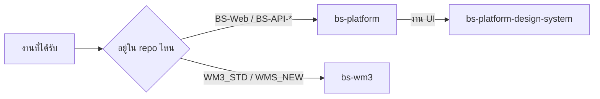

<div align="center">

# bs-skills

**ให้ AI coding agent รู้จัก BS Platform และ WM3 เหมือนคนในทีม**

ติดตั้งครั้งเดียว agent จะรู้เองว่า BSDataGrid ใช้ prop อะไร, route ต้องเพิ่มใน Ocelot, เมนู WM3 อยู่ใน DB ไหน และ MUI X ต้องเป็น `7.29.9`


[ติดตั้ง](#ติดตั้ง) · [Skill ที่มี](#skill-ที่มี) · [Script ตรวจ repo](#script-ตรวจ-repo) · [แก้ skill](#แก้-skill)

</div>

---

## ปัญหาที่แก้

| ไม่มี skill | มี skill |
| --- | --- |
| Agent สร้างตารางด้วย MUI `<Table>` เอง | ใช้ `BSDataGrid` พร้อม `bsPreObj` / `bsObj` / permission จาก menu |
| เพิ่ม endpoint ใน controller แล้ว frontend 404 | รู้ว่าต้องเพิ่ม route ใน `ocelot.json` ด้วย |
| ใส่สีแบบ hex ตรงๆ แล้วพังตอนเปิด dark mode | ใช้ token จาก `theme.js` ได้ทั้ง 6 preset |
| `npm update` แล้ว grid ขึ้น "Expired package version" | ล็อก MUI X ไว้ที่ `7.29.9` และมี script จับ |
| เพิ่มหน้า `.aspx` แล้ว publish ออกไปไม่มีหน้านั้น | รู้ว่าต้องใส่ใน `WMS_NEW.csproj` และเพิ่มเมนูใน `WM3_Security` |

## Skill ที่มี

| Skill | ครอบคลุม | Agent จะหยิบมาใช้เมื่อ |
| --- | --- | --- |
| [**bs-platform**](skills/bs-platform/SKILL.md) | Frontend-Core, DynamicController, Ocelot gateway, permission, resource, stored procedure, DB provider, AI Assistant | "เพิ่มหน้า master ลูกค้า", "grid ไม่โหลด", "เพิ่ม API ใหม่", "401 วน" |
| [**bs-platform-design-system**](skills/bs-platform-design-system/SKILL.md) | Theme token, preset สี, dark mode, ปุ่ม, layout, motion | "ทำหน้า dashboard", "ปรับ UI ให้ตรง theme", "dark mode เพี้ยน" |
| [**bs-wm3**](skills/bs-wm3/SKILL.md) | WMS_NEW (WebForms + EF6), ตาราง `t_wms_*`, เมนู `WM3_Security`, หน้า React ใน `.aspx`, DLL | "เพิ่มหน้าใน WM3", "เมนูไม่ขึ้น", "build ไม่ผ่าน CS0006" |

ไม่ต้องเรียกเอง agent จะดูจาก `description` ใน `SKILL.md` แล้วโหลดเมื่องานตรง ถ้าอยากบังคับใน Claude Code พิมพ์ `/bs-platform`, `/bs-platform-design-system` หรือ `/bs-wm3`



## ติดตั้ง

ต้องมี **Node.js 22+** และสิทธิ์อ่าน repo นี้

```bash
npx skills add phayungsakp/bs-skills -g --skill '*' -a claude-code codex cursor gemini-cli github-copilot -y
```

ลงครบ 3 skill ให้ agent ที่ทีมใช้ในคำสั่งเดียว ถ้าใช้ agent อื่นให้เพิ่มชื่อหลัง `-a` (ใส่ชื่อผิด CLI จะแสดงรายชื่อที่ใช้ได้)

> [!NOTE]
> อย่าใช้ `-g --all` เพราะ `--all` ลงให้ **ทุก** agent ที่ CLI รู้จัก ซึ่งมี `eve` กับ `promptscript` ที่ไม่รองรับการติดตั้งแบบ global จะขึ้น `Failed to install 6` แต่ skill ลงให้ agent อื่นครบแล้ว ไม่ต้องทำอะไรเพิ่ม

| ต้องการ | คำสั่ง |
| --- | --- |
| เลือก agent / skill แบบถามตอบ | `npx skills add phayungsakp/bs-skills -g` |
| ลงแค่ skill เดียว | `npx skills add phayungsakp/bs-skills -g --skill bs-wm3 -a claude-code codex -y` |
| ลงเข้า project (รันที่ root ของ project) | `npx skills add phayungsakp/bs-skills --all` |
| อัปเดตเป็นเวอร์ชันล่าสุด | `npx skills update -g` |
| ถอนการติดตั้ง | `npx skills remove bs-platform bs-platform-design-system bs-wm3 -g` |

<details>
<summary><b>npx clone ไม่ได้</b> (repo private / อยู่หลัง proxy)</summary>

<br>

clone ผ่าน SSH เองแล้วติดตั้งจาก path

```bash
git clone git@github.com:phayungsakp/bs-skills.git
```

```bash
npx skills add ./bs-skills -g --skill '*' -a claude-code codex cursor gemini-cli github-copilot -y
```

</details>

<details>
<summary><b>ติดตั้งเองโดยไม่ใช้ npx</b></summary>

<br>

copy ทุกโฟลเดอร์ใน `skills/` ไปไว้ที่โฟลเดอร์ skill ของ agent

| Agent | Global | Project |
| --- | --- | --- |
| Claude Code | `~/.claude/skills/` | `.claude/skills/` |
| Codex และ agent ทั่วไป | `~/.agents/skills/` | `.agents/skills/` |

</details>

## Script ตรวจ repo

`bs-platform` มี script ตรวจ repo BS Platform agent จะรันเองตอนเริ่มงาน หรือจะรันเองก็ได้

```bash
powershell -NoProfile -ExecutionPolicy Bypass -File skills/bs-platform/scripts/bs-profile.ps1 -Root "D:\path\to\BS-Platform"
```

ผลจริงตอนรันกับ BS-Platform-Template (ตัดบางส่วน)

```text
[Frontend] ...\BS-Platform-Template\BS-Web\Frontend-Core
  homepage        : .
  react                 : ^19.1.0
  @mui/x-data-grid      : ^7.29.9
  @mui/x-data-grid-pro  : ^7.29.9
  lockfile        : package-lock.json
  [WARN] package.json @mui/x-data-grid is '^7.29.9', must be exactly '7.29.9'
  [WARN] package.json @mui/x-data-grid-pro is '^7.29.9', must be exactly '7.29.9'
  lock node_modules/@mui/x-data-grid                       : 7.29.12
  [WARN] lockfile node_modules/@mui/x-data-grid is 7.29.12, license requires 7.29.9 ('Expired package version' risk)
  lock node_modules/@mui/x-data-grid-pro                   : 7.29.9

[Gateway] ...\BS-API-Secure\ApiGateway\ocelot.json - 110 routes
  bs_api_mobile             : 45 routes
  auth_api                  : 22 routes
  bs_core_api               : 19 routes
  ...

[DynamicController] 17 operations

[ApiCore] AllowedSchemas: dbo,sec,tmt,imp,ams,rfi,inv,noti,rpt,ais

[docker-compose] api_gateway, auth_api, bs_core_api, bs_import_export_manager, bs_notification, bs_web, bs_report_viewer, bs_ai_assistance, bs_api_mobile

Done. 3 warning(s).
```

| ตรวจอะไร | เตือนเมื่อ |
| --- | --- |
| Version ของ stack, lockfile, base path, API URL | ไม่มี lockfile หรือมีมากกว่าหนึ่งตัว |
| MUI X ใน `package.json` และ `package-lock.json` | ตัวไหนก็ตามไม่ใช่ `7.29.9` |
| Route ของ DynamicController กับ `ocelot.json` | มี operation ที่ไม่มี route ใน gateway |
| Gateway route แยกตาม service, route ที่ไม่ต้อง login | — (แสดงข้อมูล) |
| `AllowedSchemas`, service ใน docker-compose | — (แสดงข้อมูล) |

ถ้ามี warning จะ exit 1 เอาไปใส่ใน CI ได้

> [!IMPORTANT]
> **License MUI X ของทีมใช้ได้กับ `@mui/x-data-grid` และ `@mui/x-data-grid-pro` เวอร์ชัน `7.29.9` เท่านั้น**
>
> แก้ด้วยคำสั่งนี้ที่ `BS-Web/Frontend-Core` คำสั่งเดียวแก้ทั้ง `package.json` และ lockfile แล้ว commit ทั้งสองไฟล์พร้อมกัน
>
> ```bash
> npm install @mui/x-data-grid@7.29.9 @mui/x-data-grid-pro@7.29.9 --save-exact
> ```
>
> อย่าแก้เลข version ใน `package-lock.json` ด้วยมือ เพราะ `resolved` กับ `integrity` ยังชี้ไปที่ไฟล์ของเวอร์ชันเก่า `npm ci` จะพัง

## โครงสร้าง

```text
bs-skills/
├── skills/
│   ├── bs-platform/
│   │   ├── SKILL.md                  กฎหลัก, page pattern, verification
│   │   ├── references/
│   │   │   ├── bsdatagrid.md         prop ทั้งหมดของ BSDataGrid / Client
│   │   │   ├── backend-gateway.md    DynamicController, Ocelot, DB provider, SP
│   │   │   ├── frontend.md           boot order, env, hooks, tests
│   │   │   └── ai-assistant.md       AI service, route, ตาราง ais.t_ai_*
│   │   └── scripts/
│   │       └── bs-profile.ps1        ตรวจ repo
│   ├── bs-platform-design-system/
│   │   └── SKILL.md                  token, preset, dark mode, checklist
│   └── bs-wm3/
│       └── SKILL.md                  WMS_NEW, DB, เมนู, React ใน WebForms
├── README.md
└── LICENSE
```

## แก้ skill

Skill ที่ข้อมูลเก่าอันตรายกว่าไม่มี skill เลย เพราะ agent จะเชื่อสิ่งที่เขียนไว้ เวลา repo เปลี่ยน (prop, route, schema, version) ให้แก้ skill ใน PR เดียวกัน

- [ ] 1 skill = 1 โฟลเดอร์ใน `skills/` ชื่อโฟลเดอร์ตรงกับ `name` ใน frontmatter
- [ ] `description` ขึ้นต้นด้วย `Use when ...` บอกแค่ว่าใช้ตอนไหน ไม่สรุปขั้นตอน
- [ ] ทุกข้อเท็จจริงเช็คกับ source จริง ไม่ใช่จากความจำ
- [ ] เนื้อหายาวไว้ใน `references/` ส่วนเครื่องมือไว้ใน `scripts/`
- [ ] ก่อน push รัน `npx skills add . --list` แล้วต้องเห็นครบทุก skill

---

<div align="center">
<sub>สำหรับใช้ภายใน OGA เท่านั้น ดู <a href="LICENSE">LICENSE</a></sub>
</div>
